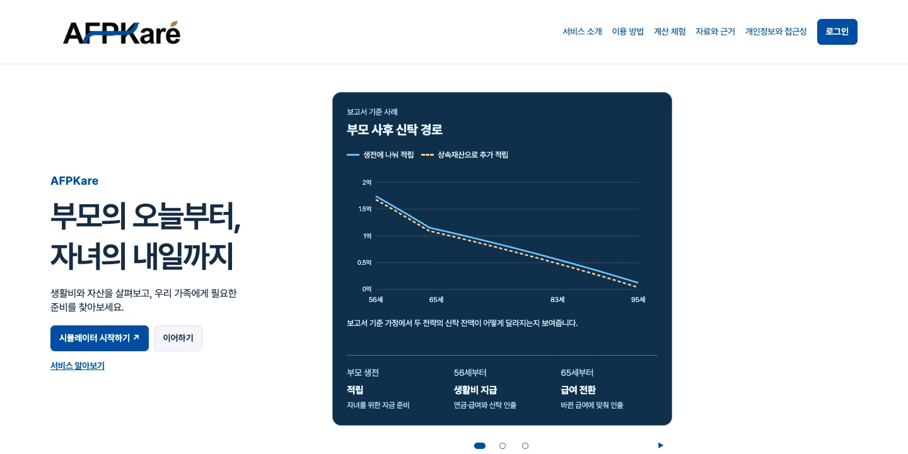
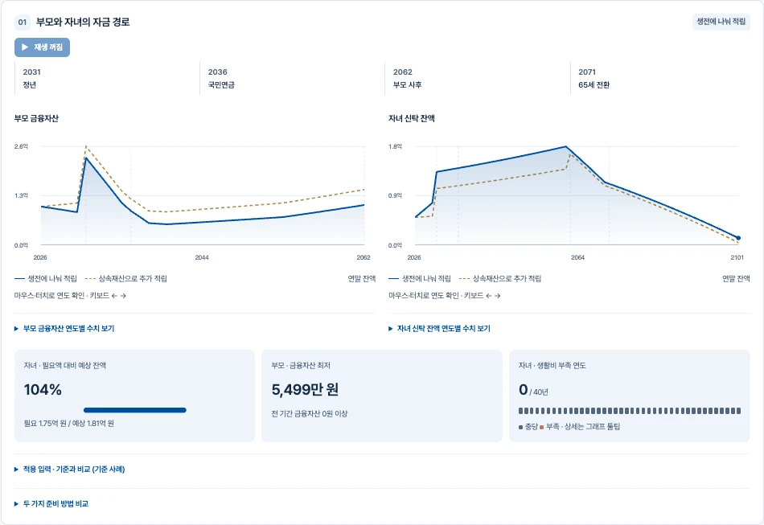
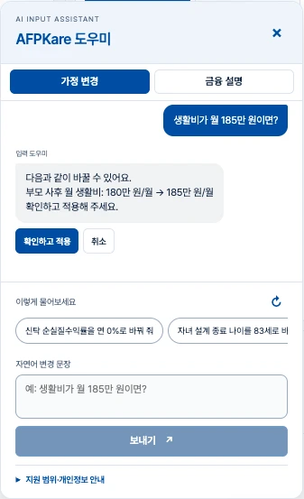
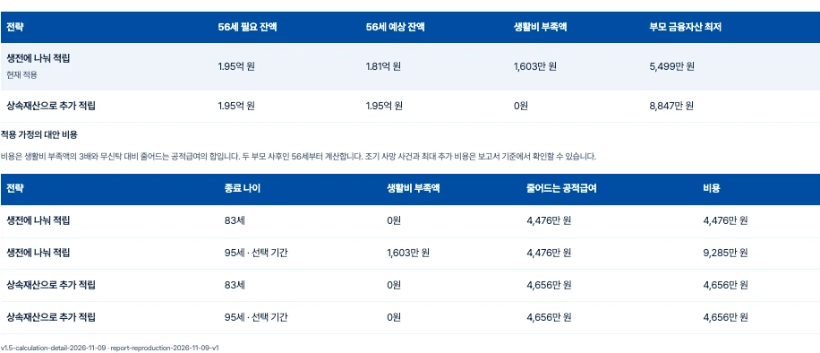
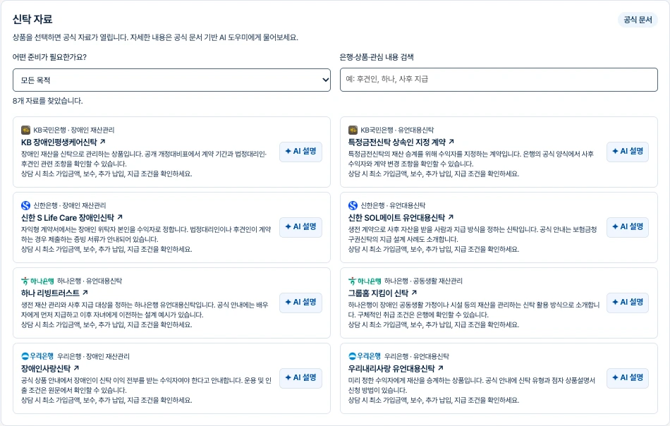
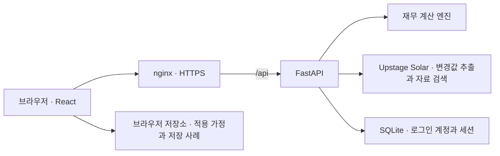

# AFPKare

**부모의 노후 자금과 자녀의 평생 생활비를 함께 살펴보는 재무설계 시뮬레이터**

AFPKare는 성인 발달장애 자녀를 둔 가상의 지훈 씨 가족이 부모의 노후와 부모 사망 후 자녀의 생활비를 함께 준비하는 과정을 보여줍니다. 월 생활비, 유족연금, 수익률을 바꿔 보고, 신탁에 생전에 나눠 적립하는 방법과 상속재산으로 부족분을 더 채우는 방법을 비교할 수 있습니다.

제1회 전국 대학생 AI 재무설계 콘테스트 「AFPK 영 플래너 챌린지 2026」 제출작입니다.

[공개 데모](https://158.247.203.92/) · [주요 화면](#주요-화면) · [로컬 실행](#로컬-실행) · [계산 근거](.agents/docs/arithmetic.md)



## 주요 화면

### 부모와 자녀의 자금 흐름

로그인 없이 예시 사례를 열고 월 생활비를 바꿔 볼 수 있습니다. 자녀가 생활비를 신탁에서 꺼내 쓰기 시작하는 56세의 필요 잔액과 예상 잔액을 확인하고, 생활비가 부족해지는 해와 부모의 금융자산 변화를 연도별 그래프로 살펴볼 수 있습니다.



### AI와 함께 가정 바꾸기

도우미에게 “생활비가 월 185만 원이면?”이라고 입력하면 월 생활비 변경안을 보여줍니다. Upstage Solar가 문장에서 값을 추출하고 서버가 항목·단위·범위를 검증합니다. **확인하고 적용**을 누르면 계산 엔진이 변경된 입력으로 다시 계산합니다.

<p align="center">
  
</p>

### 두 가지 준비 방법 비교

현재 입력이나 브라우저에 저장한 사례에서 두 준비 방법의 필요 잔액, 생활비 부족액, 부모의 최저 금융자산을 비교합니다. 한 가정만 바꿔 결과 차이를 살펴볼 수 있고, 계산 결과와 근거를 HTML·CSV·JSON으로 내려받을 수 있습니다.



### 신탁 자료 살펴보기

준비 목적이나 상품명으로 등록된 신탁 자료를 찾습니다. 금융 설명 도우미는 관련 자료의 요약과 공식 문서 링크를 함께 보여줍니다.

<details>
<summary>신탁 자료 화면 보기</summary>



</details>

화면은 이 저장소의 개발 버전에서 가상 사례로 캡처했습니다. 공개 데모는 배포 시점에 따라 일부 표기가 다를 수 있습니다.

## 계산 근거와 제공 범위

재무설계 보고서 v1.5의 가정과 산식을 바탕으로 부모의 연도별 금융자산, 자녀의 공적급여와 신탁 인출액을 계산합니다. 보고서의 기준값은 화면에서 가정을 바꿔 다시 계산한 값과 구분해 표시합니다.

이 데모는 가상 사례의 가정과 자금 흐름을 비교하는 용도입니다. 실제 급여 수급 여부, 세액, 상품 가입 조건은 해당 기관과 금융사에 확인해야 합니다. [계산 산식과 가정](.agents/docs/arithmetic.md) · [기능 범위](.agents/docs/frd.md)

## 기술 구성

| 영역 | 기술 | 역할 |
| --- | --- | --- |
| 화면 | React · TypeScript · Vite | 체험, 시뮬레이션 차트, 사례 비교, 브라우저 저장 |
| API·계산 | Python 3.12 · FastAPI · Pydantic | 입력 검증과 연도별 재무 계산 |
| AI | Upstage Solar · Solar Embedding | 변경값 추출과 등록된 신탁 자료 검색 |
| 로그인 | SQLite | 운영자가 발급한 선택 로그인 계정과 세션 저장 |
| 운영 | Docker Compose · nginx · Vultr · Terraform · GitHub Actions | HTTPS 제공, 인프라 관리, 테스트와 배포 |



## 로컬 실행

Python 3.12, Node.js 22 이상, npm이 필요합니다. 저장소 루트에서 실행합니다.

```bash
python3.12 -m venv backend/.venv
backend/.venv/bin/python -m pip install -r backend/requirements-dev.txt
npm ci --prefix frontend
backend/.venv/bin/python scripts/run_api.py
```

다른 터미널에서 프런트엔드를 실행하고 브라우저에서 [로컬 화면](http://127.0.0.1:5173/)을 엽니다.

```bash
npm run dev --prefix frontend
```

수동 계산은 별도 키 없이 실행됩니다. AI 기능을 사용하려면 저장소 루트의 로컬 `.env`에 `UPSTAGE_LLM_API_KEY`를 설정합니다. 환경 변수는 [예시 파일](.env.example)을 참고하세요.

로그인을 테스트하려면 `PYTHONPATH=backend backend/.venv/bin/python -m app.auth`로 로컬 계정을 생성합니다. 적용 가정과 저장 사례는 현재 브라우저에 보관됩니다.

<details>
<summary>테스트 및 빌드</summary>

```bash
backend/.venv/bin/python -m pytest -q
npm test --prefix frontend
npm run build --prefix frontend
```

</details>

## 저장소 안내

| 위치 | 내용 |
| --- | --- |
| [frontend/](frontend/) | 홈, 시뮬레이터, 보고서 비교, AI 도우미 |
| [backend/](backend/) | 재무 계산 엔진, API, 가상 사례의 계산 가정 |
| [infra/](infra/) | Vultr 인프라 정의와 Terraform 테스트 |
| [.agents/docs/](.agents/docs/) | 기능 정의, 계산 산식, 운영 문서 |

[배포 흐름](.agents/docs/cicd.md) · [HTTPS 운영](.agents/docs/https.md)
